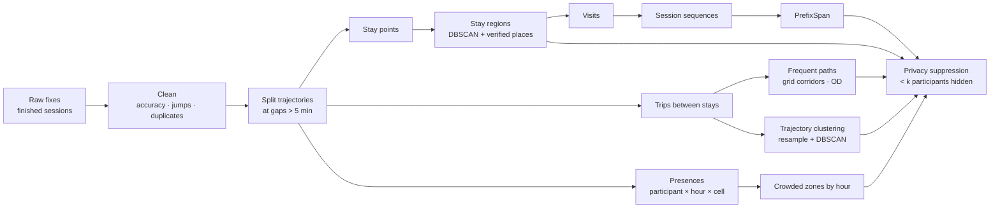

# CampusFlow analytics

Turns finished GPS sessions into the four results of the project brief: **stay points (where people stop), crowded zones by hour, frequent paths, recurring visit sequences (PrefixSpan) and trajectory clusters**. All outputs are aggregates; nothing identifies a participant or a session.

```bash
npm run setup:analytics                     # once: creates analytics/.venv
npm run analyze -- --dataset nitrr-campus-collected --places analytics/places/nitrr_places.geojson
npm run analyze -- --dataset synthetic-dev --places data/synthetic/synthetic_places.geojson   # demo data
npm run test:analytics
```

Options: `--param name=value` (any field of [params.py](campusflow/params.py), e.g. `--param stay_distance_m=40`), `--csv file --origin imported` to analyse a CSV, `--no-save` to skip MongoDB. Each run stores the result in MongoDB `analyticsresults` (shown on the web **Analytics** page) and writes `analytics/output/<dataset>.json`.

## Pipeline



| Step | Method | Key parameters (default) | Module |
|---|---|---|---|
| Cleaning | Drop invalid values, duplicate timestamps, accuracy > 50 m, implied speed > 12 m/s vs. last kept fix; split at gaps > 300 s; drop trajectories < 5 points. Every removal has a reason in the report. | `max_accuracy_m`, `max_speed_mps`, `gap_split_s` | [clean.py](campusflow/clean.py) |
| Stay points | Li et al. (2008): anchor + extend while within 50 m and no gap > 180 s; keep if ≥ 5 min. Centroid, arrival, departure, dwell. | `stay_distance_m`, `stay_min_duration_s`, `stay_max_gap_s` | [staypoints.py](campusflow/staypoints.py) |
| Stay regions | DBSCAN (eps 40 m, min 3) over all stay points; named only if a **verified place** lies within 60 m, otherwise "Unidentified region". | `region_eps_m`, `place_match_m` | [regions.py](campusflow/regions.py) |
| Visits | Consecutive stays of one session in one region < 15 min apart merge into one visit (GPS drops indoors). | `visit_merge_gap_s` | [regions.py](campusflow/regions.py) |
| Crowded zones by hour | 50 m grid; unit = *presence* (participant, local date, hour, cell), so a stationary phone never inflates counts. | `grid_cell_m`, `timezone` | [zones.py](campusflow/zones.py) |
| Frequent paths | Trips = movement between stays (≥ 100 m). Densified, mapped to grid cells; each adjacent-cell step is a corridor edge counted once per trip. Plus region→region trip counts. | `min_trip_length_m` | [paths.py](campusflow/paths.py) |
| PrefixSpan | Own implementation (Pei et al. 2001). Sequence = ordered regions visited in a session (consecutive repeats collapsed). Support = sessions containing the pattern in order, gaps allowed. Verified against brute force on random data. | `prefixspan_min_support` (3), `prefixspan_max_length` (5) | [prefixspan.py](campusflow/prefixspan.py) |
| Trajectory clustering | Trips resampled to 20 points by arc length; distance = mean point-wise metres (direction-aware); DBSCAN on the precomputed matrix. Cluster lines are *mean paths*, never one person's trip. | `cluster_eps_m` (35), `cluster_min_samples` (3) | [clustering.py](campusflow/clustering.py) |
| Privacy | Every aggregate (region, zone-hour, weekday/weekend bar, corridor edge, OD pair, pattern, transition, cluster path) needs ≥ `min_participants` distinct participants. | `min_participants` (3) | all |

Each result also contains a **sensitivity sweep** (stay thresholds, clustering eps/min-samples, PrefixSpan support), contribution imbalance, and the exact parameters, algorithm version and projection used.

### Why these choices

* **Local metric projection** (equirectangular around the data's median point): over a campus its distance error is far below GPS noise, and every threshold can be stated in metres.
* **Grid for paths, not raw coordinates**: two walks along the same footpath never share exact coordinates. Cell size trades separation of parallel paths against splitting one noisy path. Map-matching to a campus footpath network would be better once such a network exists.
* **Resampled point-wise distance over DTW**: trips between the same places differ mainly in speed and sampling rate, which arc-length resampling removes; it is O(N) per pair instead of O(N²) and easy to explain. Direction matters by design.
* **DBSCAN** in both places: no need to choose the number of clusters, and odd trips or lone stops become noise instead of being forced into a group.

### Limitations

* Small, self-selected sample; participants contribute unevenly (reported in the result). Findings describe *the participants' observed movement*, not the campus population, and zone activity is **not** crowd size.
* Browser GPS stops when the screen locks, and indoor fixes are poor; long indoor stays may be split or missed.
* No ground truth: the sensitivity tables are exploratory, not accuracy scores. A small hand-labelled set (e.g. "I was in the library 10:00–11:00") would allow precision/recall for stay points.
* A stay region near a verified place is *probably* that place. GPS cannot say what anyone did there.

## Campus places

Copy [places/nitrr_places.template.geojson](places/nitrr_places.template.geojson) to `places/nitrr_places.geojson` and add Point features with **verified** coordinates (measured on site, or from an authoritative campus map), each with `placeId`, `name`, `category`, `dataSource` and `verificationStatus`. Nothing is bundled: this repository contains no NIT Raipur coordinates.

## Synthetic data

`npm run seed -- --csv` generates the `synthetic-dev` dataset around fictional places with deliberate defects (drift, poor fixes, jumps, signal gaps). The dashboard draws it without a street map and labels it "SYNTHETIC". Use it to rehearse and test, never as findings.
