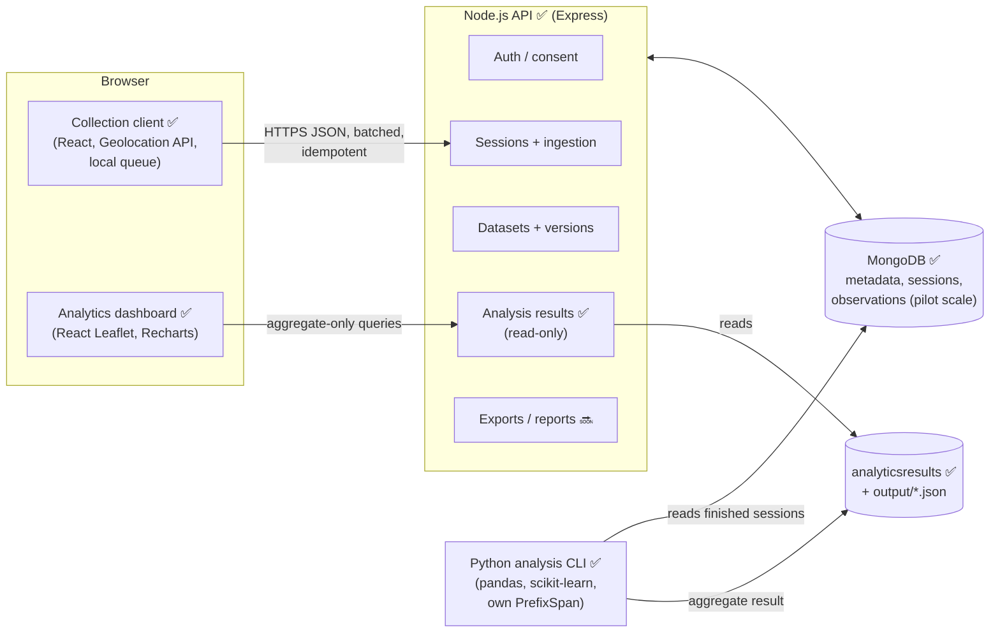
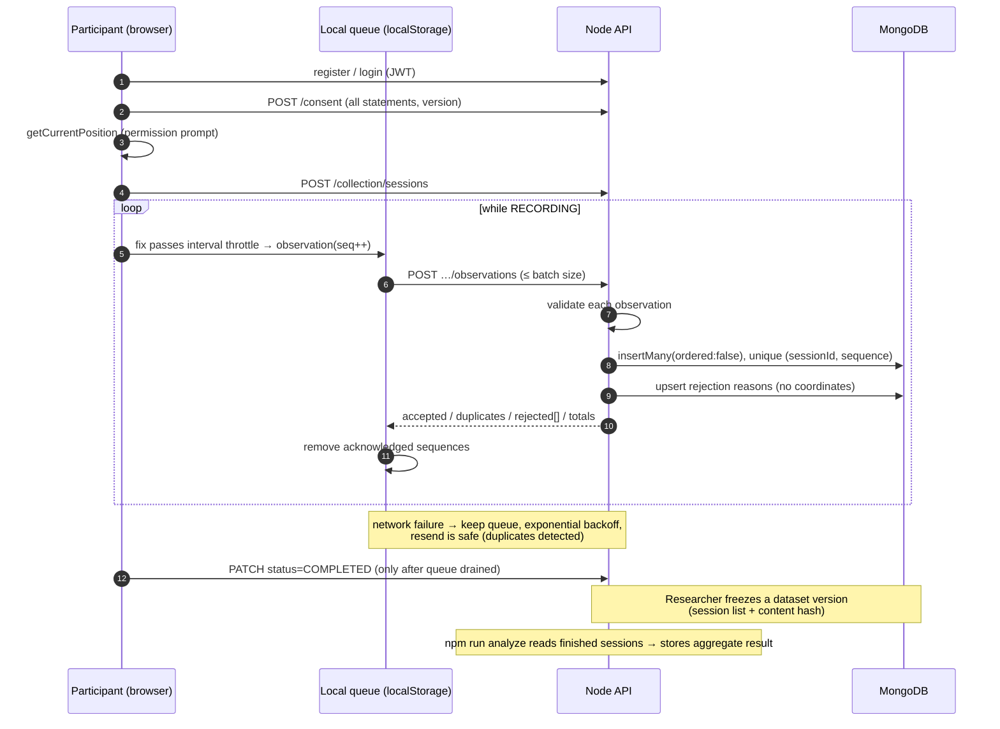
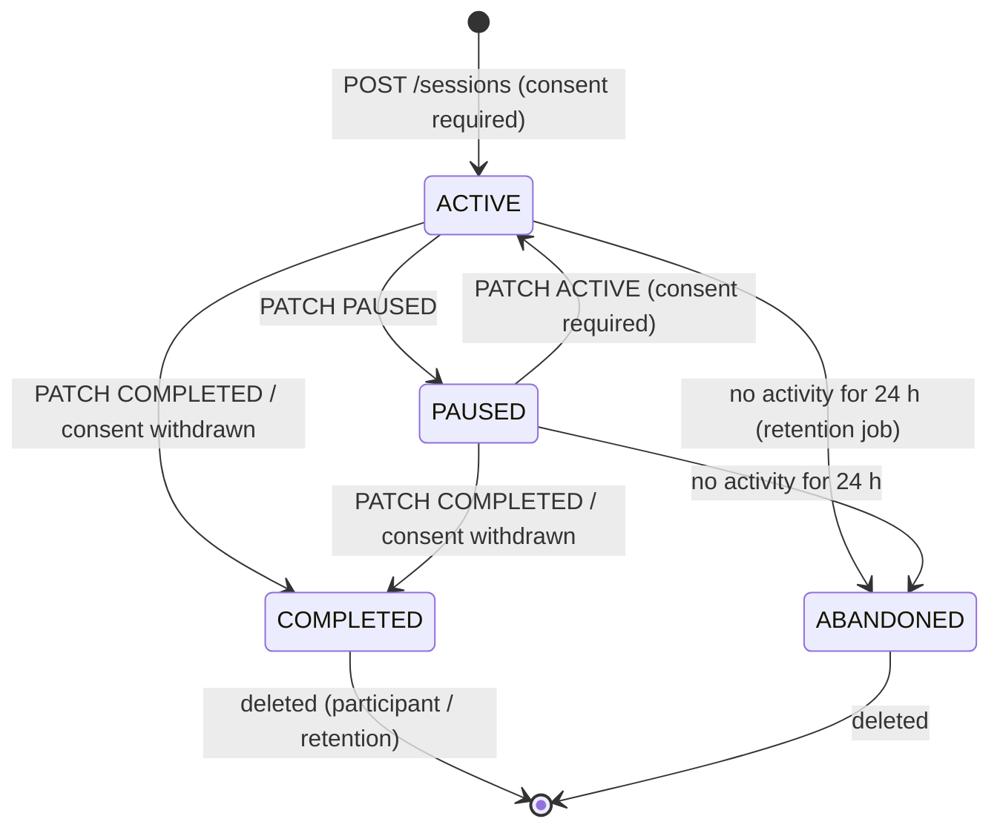
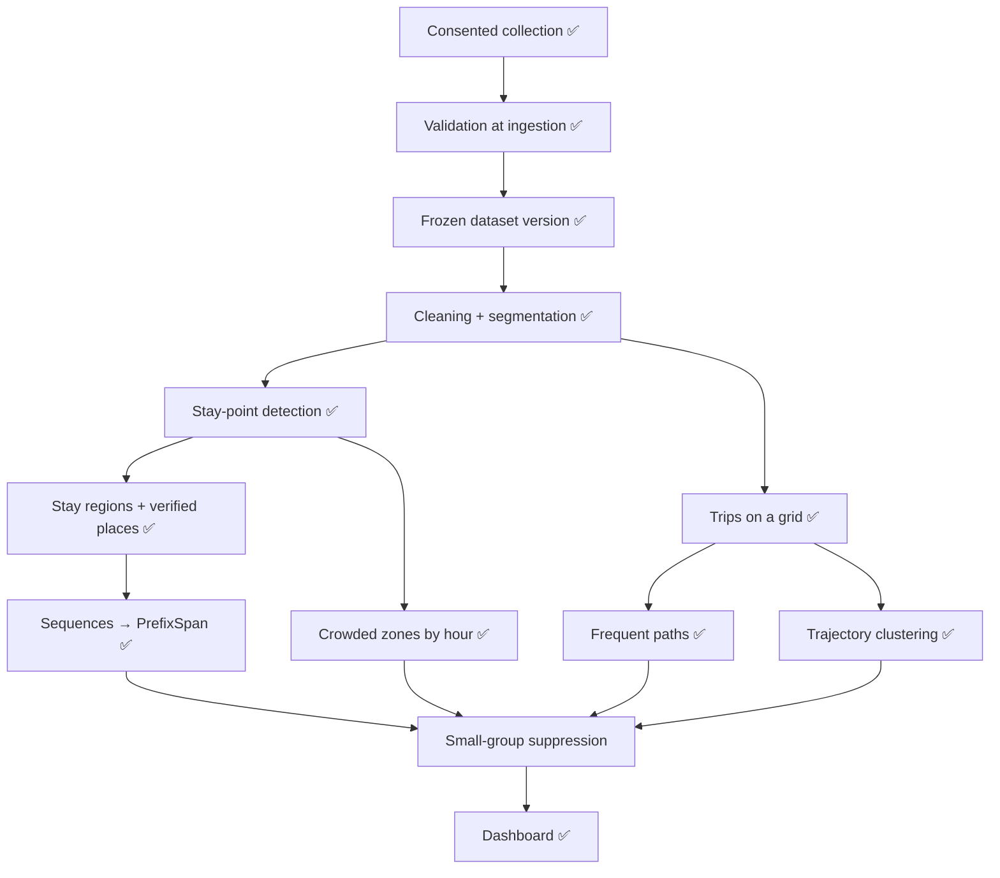

# CampusFlow architecture

Status legend: ✅ implemented · 🔜 not built (out of the current, reduced scope)

> Scope update: the project follows the short brief (collection → stay points, crowded zones by hour, frequent paths, PrefixSpan, trajectory clustering). Analysis runs as a command (`npm run analyze`) whose result the API serves to the dashboard; the FastAPI job service, import/export module and report generator from the original plan are not built.

## System architecture

### Responsibilities

| Component | Owns | Never does |
|---|---|---|
| Collection client | Consent UI, location capture during an active session, throttling to the sampling interval, local durable queue, batch upload with retry | Records outside a session; records silently after a reload; sends user-agent or device IDs |
| Node.js API | Accounts, consent records, session lifecycle, observation validation and idempotent storage, deletion, retention, dataset versions, audit log, (later) job orchestration and access control for results | Runs expensive analytics inside request handlers |
| MongoDB | Metadata and, at pilot scale, raw observations | Holds published aggregates mixed with raw data |
| Python analysis CLI | Cleaning, segmentation, stay points, place matching, hourly aggregation, route mining, PrefixSpan, clustering | Accesses account identities (it only sees `participantId`) |
| Analytics dashboard | Aggregate visualisation with small-group suppression | Shows individual trajectories |

## Data flow

### Idempotency and counting

* Each observation carries a client-assigned `sequence`, persisted locally so it is never reused after a reload.
* MongoDB enforces a unique index on `(sessionId, sequence)`. A resend of identical content → `duplicates`; same sequence with different content → rejected as `sequence_conflict` (the original is kept).
* Session counters (`acceptedObservationCount`, `rejectedObservationCount`) are **recomputed** from stored rows after each batch, never incremented, so retries cannot inflate them. Rejection rows are unique on `(sessionId, sequence, reason)`.

### Session lifecycle

Uploads are accepted only in `ACTIVE` and `PAUSED` (paused sessions may still be draining their queue). Pause intervals are stored so preprocessing can distinguish deliberate gaps from signal loss.

## Research methodology flow (target)

## Key design decisions

* **Separate Python service.** Geospatial and mining libraries are mature in Python; isolating them keeps the API responsive and lets analyses run as jobs against immutable dataset versions.
* **MongoDB for observations at pilot scale only.** One document per fix is simple and supports per-session deletion. For larger studies, frozen versions are materialised to Parquet and the analytics service reads those files; MongoDB keeps only references.
* **No silent drops.** Ingestion rejects only malformed or physically impossible values, with recorded reasons. Plausible-but-poor data (low accuracy, jumps) is stored and handled by the cleaning pipeline, which records why each point was flagged.
* **Synthetic data isolation.** Synthetic sessions live in `synthetic-dev` with `dataOrigin: synthetic`; versioning refuses to freeze a dataset that mixes origins.
