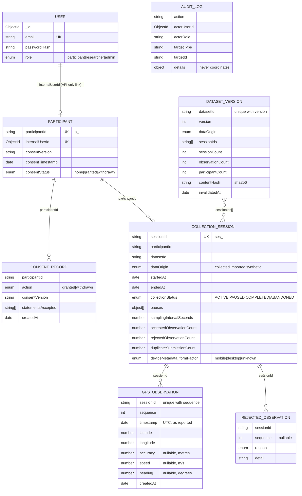

# Data model and lifecycle

## ER diagram (Phase 1)

`AnalyticsJob` and `AnalyticsResult` (Phases 2–6) will reference `datasetId` + `version`, `algorithmVersion` and full parameters.

## Indexes

| Collection | Index | Purpose |
|---|---|---|
| gpsobservations | `{sessionId, sequence}` unique | idempotent ingestion |
| gpsobservations | `{sessionId, timestamp}`, `{timestamp}` | per-session time order; time-window queries |
| rejectedobservations | `{sessionId, sequence, reason}` unique | retry-safe rejection counts |
| collectionsessions | `sessionId` unique; `participantId`; `datasetId`; `collectionStatus` | ownership, dataset summaries, retention |
| datasetversions | `{datasetId, version}` unique | version numbering |

## Rejection reasons

`invalid_schema`, `invalid_latitude`, `invalid_longitude`, `invalid_timestamp`, `timestamp_in_future`, `timestamp_before_session`, `timestamp_after_session`, `invalid_accuracy`, `invalid_speed`, `invalid_heading`, `outside_study_area`, `duplicate_in_batch`, `sequence_conflict`.

Timestamps must be ISO‑8601 **with** a zone (`Z` or `±hh:mm`); a configurable clock-skew allowance (default 300 s) applies to the session bounds and the "future" check. Rejection rows store no coordinates.

## Lifecycle

| Stage | Where | Who can read | Deleted when |
|---|---|---|---|
| Unsent queue | Participant's browser (localStorage) | Participant's device | Acknowledged by server; sign-out; session deletion |
| Raw observations | MongoDB `gpsobservations` | Owner (own sessions only); analytics pipeline via frozen versions (P2) | Participant deletes session/all/account; consent withdrawal with deletion; retention (`RETENTION_DAYS`) |
| Dataset version | MongoDB `datasetversions` (metadata) → Parquet (P2) | Researchers | Invalidated automatically if any included session is deleted |
| Processed data (P2+) | Parquet, per version | Researchers | With its dataset version |
| Published aggregates (P4+) | Result artifacts | Public/dashboard, after small-group suppression | Not individually retractable; contain no individual trajectories |

Deleting data that was part of a frozen version marks that version `invalidatedAt` with a reason, so analyses are never silently re-run on data that no longer exists.
